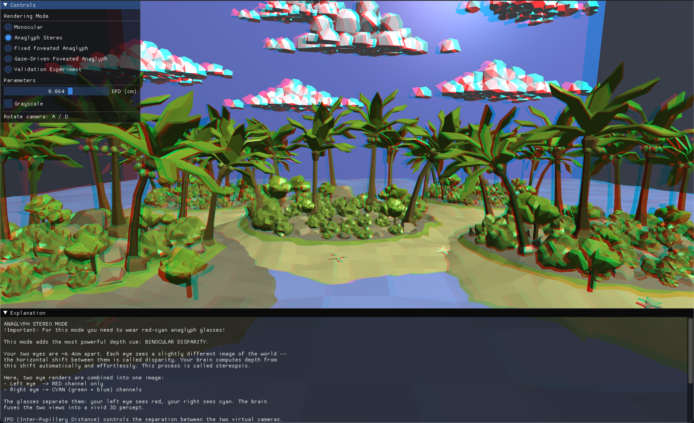
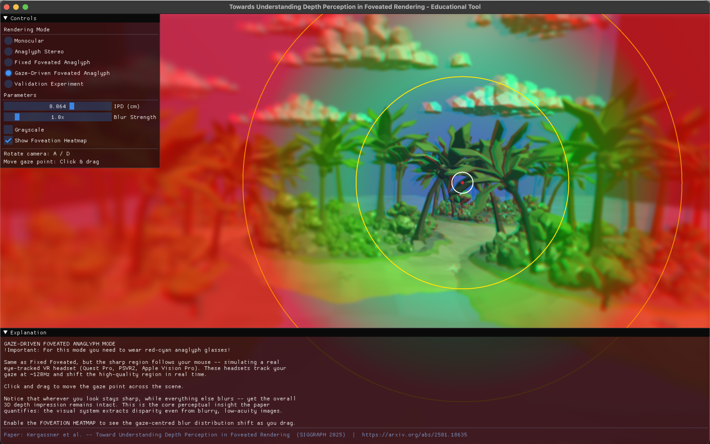
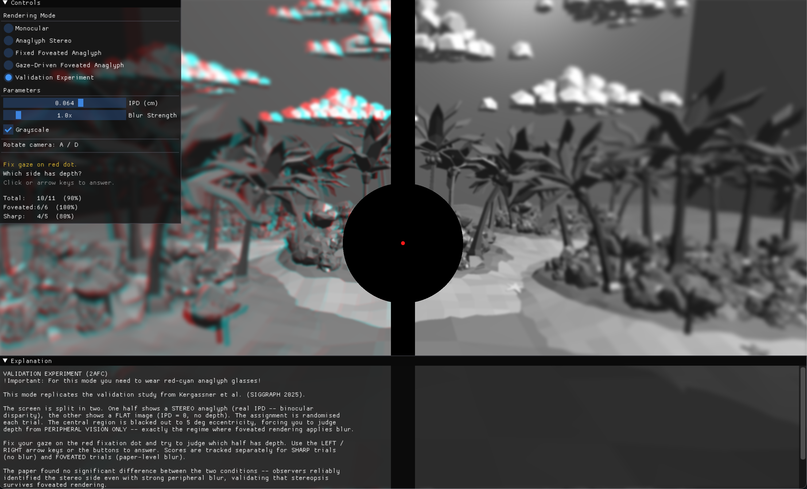

# Educational Tool: Towards Understanding Depth Perception in Foveated Rendering

**Student**: Jan Kuhta (6539653) | CGV Seminar 2026

## 1. What Was Done

This project introduces an interactive educational tool for practical understanding of Kergaßner et al. (2025). It was
built in
Python using ModernGL and ImGui. It renders a 3D island scene with five rendering modes: **Monocular**, **Anaglyph
Stereo**, **Fixed Foveated Anaglyph**, **Gaze-Driven Foveated Anaglyph**, and a **Validation Experiment**. Each mode
includes a side panel and a bottom panel with educational text explaining the underlying theory, background, and
interactive
tips. The tool is optimised for a **27" 2560×1440 16:9 monitor at 60 cm** — all spatial parameters are derived from the
paper's measurements for this setup. It can be used on other displays, but will not accurately reflect the perceptual
parameters.

## 2. Connection to the Paper

The paper investigates whether foveated rendering harms stereoscopic depth perception, finding that current foveation
methods do not impair it and that there is nearly 2× headroom before they would. The tool implements the paper's core
concepts directly in an interactive setting. Similarly to the paper, this tool uses peripheral blur to emulate the lower
resolution rendering at periphery.

Binocular disparity is demonstrated through the anaglyph modes, where the IPD slider lets users directly feel how
virtual camera separation creates the sensation of depth. The peripheral blur is derived from the p2 parameter of
the paper's fitted model: $p_2(\theta) = 8.85 \cdot e^{0.04 \cdot \theta} - 7.5$, which gives the optimal blur sigma in
arcminutes as a function of eccentricity in degrees. These values are converted to pixels for the 27" setup and applied
per-pixel in the fragment shader, with a user-controlled multiplier to explore blur levels beyond the paper's
optimal values. The foveation heatmap visualises how blur intensity gradually increases from the fovea into the
periphery,
and marks the fovea boundary alongside the paper's measurement eccentricities at 10° and 20°. The Validation
experiment mode replicates the paper's validation experiment — the screen splits into a stereo half and a flat (IPD = 0)
half,
randomly
assigned each trial, with the center blacked out to force peripheral-only depth judgment and separate score tracking
for foveated and sharp conditions.

## 3. Educational Use

The tool is structured to guide the user through the paper's core concepts progressively. Each mode has a supportive
content panel at the bottom. Starting in **Monocular**
mode, the user can explore the scene and notice that depth estimation is still possible from monocular cues (size,
occlusion, shading, perspective), but feels imprecise and flat. This establishes an intuitive baseline for what
monocular depth cues alone can provide.

Switching to **Anaglyph Stereo** mode (red-cyan glasses required) immediately demonstrates the power of binocular
disparity — the scene gains a clear sense of volume that was absent before. The IPD slider lets the user control stereo
separation directly, making it easy to understand how virtual camera distance drives disparity and depth.

The **foveated modes** demonstrate introduce the paper's central question: how much can peripheral quality be reduced
before depth perception degrades? The foveation heatmap (Figure 2) visualises the blur distribution with eccentricity
rings at 1°, 10°, and 20° matching the paper's measurement points. The Blur Strength slider lets the user push blur well
beyond the paper's
threshold to find the point where depth perception actually starts to break down. In **Gaze-Driven** mode the user can
drag the gaze point
to simulate a real eye-tracked VR headset.

The **Validation Experiment** mode (Figure 3) provides a direct replication of the paper's validation experiment. The
paper's
experiment description is brief, so this mode also serves as a concrete interpretation of the methodology. The user must
judge which side of a split screen has stereo depth using only peripheral vision, with the fovea blacked out. Scores are
tracked separately for foveated and sharp trials. It is expected that the accuracy is high and that there is no
significant difference in results between the two conditions. Users are encouraged to experiment with the Blur Strength
and IPD sliders to find their own personal thresholds — the point where blur starts to impair depth judgment, or where
IPD becomes too low or high for reliable fusion. The tool was informally tested with two participants — P1 scored 14/15
foveated and 13/15 sharp, P2 scored 12/15 on both — consistent with the paper's finding that foveated blur does not
significantly impair stereoacuity. Results should be interpreted cautiously given the non-VR setup and small sample.

{ width=49% }
{ width=49% }

Figure 1 (left): Anaglyph mode showing red/cyan disparity fringing. IPD slider and grayscale toggle visible in sidebar.
Bottom panel shows mode explanation.
Figure 2 (right): Foveated anaglyph with heatmap overlay. Blue = sharp (fovea), red = blurred (periphery). Rings at 1°,
10°, 20° eccentricity. Gaze-driven mode with mouse-controlled fovea position.

{ width=70% }

Figure 3: Validation experiment. Screen split into stereo (real IPD) and flat (IPD=0) halves, randomly assigned.
Center blacked out to force peripheral depth judgment. Score panel shows foveated vs sharp accuracy separately.
Grayscale mode for clearer stereo image.

## External Sources

**3D Scene Asset** — Low-poly desert island kit, CGTrader.
URL: https://www.cgtrader.com/free-3d-models/exterior/landscape/low-poly-desert-island-kit
Licence: Royalty-free. Adaptation: duplicated five times for a denser scene.

**Paper Reference** — Kergaßner et al. (2025). *Toward Understanding Depth Perception in Foveated Rendering.* ACM
SIGGRAPH 2025.

## Declarations

**AI Assistance** — AI tools (ChatGPT) were used for initial project structure brainstorming, debugging assistance,
minimal
coding support, and polishing the report language. Methods written with AI assistance are marked in the source code with
`AI Disclaimer`.